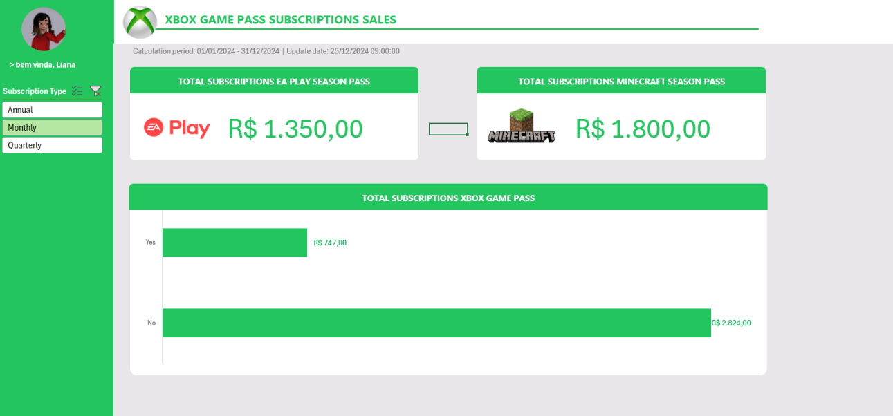

# 🎮 Dashboard & Análise de Vendas: Xbox Game Pass Subscriptions

Este repositório contém uma análise de dados e dashboard interativo desenvolvido em **Microsoft Excel** (`VENDAS-XBOX.xlsx`), focado na consolidação de métricas de vendas, comportamento de assinantes e desempenho de passes adicionais (EA Play e Minecraft Season Pass) do serviço **Xbox Game Pass**.

---

## 🎯 Objetivo do Projeto

O objetivo deste projeto é responder a perguntas de negócio estratégicas sobre a base de subscrições, fornecendo visibilidade clara sobre faturamento, renovação automática, distribuição de planos e adesão a complementos (add-ons).

---

## 📊 Perguntas de Negócio Analisadas

A estrutura do projeto foi modelada para responder a questões-chave:

1. **Faturamento Total por Tipo de Plano:** Avaliação do faturamento gerado pelos planos mensais, trimestrais e anuais (Core, Standard e Ultimate).
2. **Análise de Auto-Renovação:** Impacto da renovação automática (*Auto Renewal*) no faturamento total de vendas.
3. **Desempenho do EA Play Season Pass:** Mapeamento do total de vendas do passe adicional EA Play por categoria de plano.
4. **Desempenho do Minecraft Season Pass:** Mapeamento e consolidação das vendas do passe adicional de Minecraft.
5. **Efetividade de Cupons:** Levantamento dos descontos aplicados (*Coupon Value*) e seu impacto no valor final arrecadado.

---

## 🧩 Estrutura do Ficheiro Excel

O ficheiro é composto por folhas de trabalho organizadas de forma modular:

* **`Dashboard`**: Painel visual executivo configurado com a identidade visual da marca Xbox, integrando indicadores-chave (KPIs), gráficos e segmentadores de dados (slicers).
* **`Bases`**: Base de dados estruturada contendo registros de subscritores, planos (Core, Standard, Ultimate), tipo de cobrança, renovação automática, valores e complementos.
* **`Cálculos`**: Tabelas dinâmicas e fórmulas de consolidação de dados (`GETPIVOTDATA` / `INFOTABELAAGRUPADA`, somas condicionais).
* **`Assets`**: Guias de estilo contendo a paleta de cores institucional da Xbox (`#9BC848`, `#22C55E`, etc.), ícones e elementos visuais de apoio à interface.

---

## 🛠️ Tecnologias e Recursos Utilizados

- **Microsoft Excel**
  - Tabelas Dinâmicas (*Pivot Tables*) e Gráficos Dinâmicos.
  - Segmentação de Dados (*Slicers*) para navegação interativa.
  - Fórmulas de consolidação financeira e tratamento de dados.
  - Design e UX/UI voltados para Dashboards Executivos.
- **Git & GitHub**: Controlo de versão e documentação técnica pública.

---

## 📸 Demonstração Visual



---

## 📂 Estrutura do Repositório

```text
├── images/
│   └── dashboard-xbox.png
├── VENDAS-XBOX.xlsx
└── README.md
